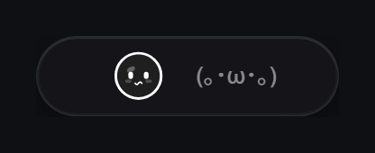
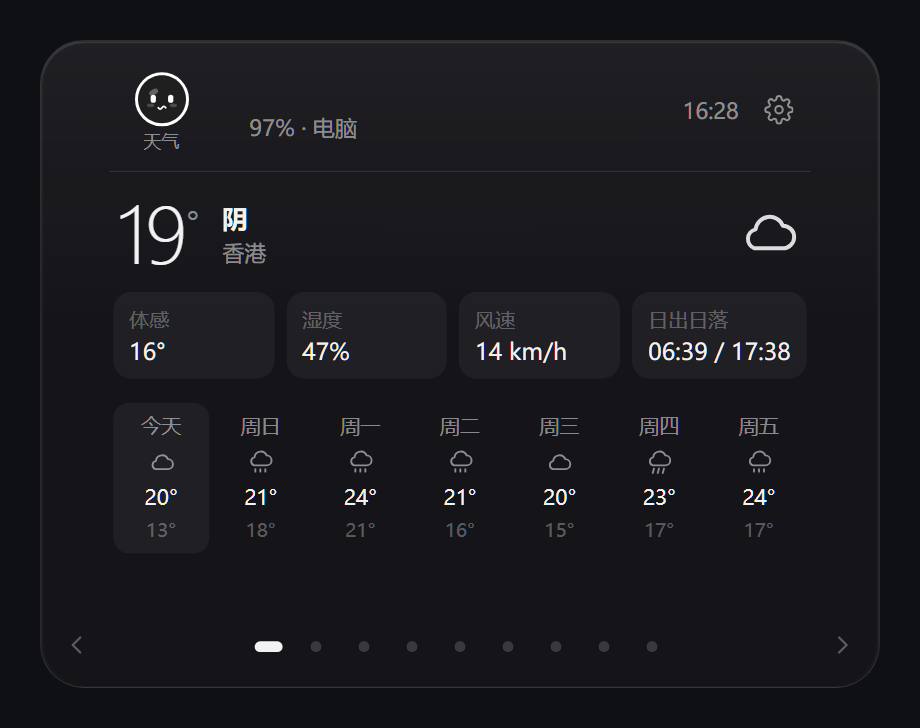

<div align="center">

# EmojiTot

**A character engine drawn in SVG: <!--facts:cast-->15<!--/facts--> characters with hand-written outlines, <!--facts:faceStates-->61<!--/facts--> expressions, one two-digit protocol. Visible in a page, and now living on the desktop — both a pill at the top of the screen and a ball on the desk.**

[Console](https://onestar1107.github.io/emoji-tot/#/console) · [Faces](https://onestar1107.github.io/emoji-tot/#/gallery) · [Scene](https://onestar1107.github.io/emoji-tot/#/scene) · [Docs](https://onestar1107.github.io/emoji-tot/#/docs) · [中文](README.md)


</div>

---

## What it is

**A character is a genome, not an image.** No spritesheets, no Lottie files, and not one hand-drawn character: a character is `{ body, color, face }` — the body is a hand-written closed Bezier outline, the colour picks the ink for the face (inverted by luminance), and the expression is a small vocabulary of eyes and mouths. Add a row and there is a new character.

<!--facts:bodies-->15<!--/facts--> bodies, <!--facts:colors-->12<!--/facts--> colours, <!--facts:faceStates-->61<!--/facts--> expressions (<!--facts:eyeStyles-->10<!--/facts--> eye styles × <!--facts:mouthStyles-->12<!--/facts--> mouth styles plus lean), two finishes (die-cut sticker / flat), and `breed(a, b, seed)` to cross two genomes without storing anything.

Three parts, all written from scratch in this repository: `packages/core` (hand-written outlines, expression vocabulary, finishes, SVG out), `packages/protocol` (two-digit ids, parsing, multi-session arbitration, event bridge), and `apps/desktop` / `apps/gallery` (the Windows app; the console / faces / scene / docs site).

## Demo




Folded, it is just a face; click it and it grows into a 420px panel in place. The desktop ball stays anywhere, and tucks halfway off the screen when dragged to a side edge.

## Install

<!--downloads:start-->
| File | For |
| --- | --- |
| [EmojiTot.Setup.0.8.7.exe](https://github.com/OneStar1107/emoji-tot/releases/download/v0.8.7/EmojiTot.Setup.0.8.7.exe) | Installer — starts from the Start menu |
| [EmojiTot.0.8.7.exe](https://github.com/OneStar1107/emoji-tot/releases/download/v0.8.7/EmojiTot.0.8.7.exe) | Portable — double-click, writes nothing to the registry |
<!--downloads:end-->

Windows x64 · unsigned (SmartScreen may ask you to run it anyway) · [all releases](https://github.com/OneStar1107/emoji-tot/releases) · current <!--facts:version-->0.8.7<!--/facts-->

The version here is kept in sync with `package.json` by `pnpm docs:sync`. If that release has not been tagged yet the links 404 — take the current published build from all releases.

Build from source (Windows, Node ≥ 22.12, pnpm ≥ 12):

```bash
pnpm approve-builds --all   # pnpm 12 skips dependency build scripts by default; Electron needs one
pnpm install
pnpm build                  # builds core and protocol
pnpm dev                    # site at http://localhost:5173
pnpm desktop                # the desktop app (island by default)
pnpm test                   # protocol and engine tests
pnpm scan                   # sensitive-information scan, run before publishing
pnpm smoke:desktop          # launch a real Electron window and check sandbox and layout
```

Electron 45 cannot start from a repository path containing non-ASCII characters: the development launcher builds a one-time ASCII runtime cache (about 374 MB) under `%LOCALAPPDATA%\EmojiTot\electron-runtime`; set `EMOJITOT_ELECTRON_CACHE` to use another ASCII-only directory.

## Five things it does

1. **Two forms** — an island pill at the top of the screen, or a ball that docks to an edge; switch from the tray or settings without a restart and without losing the current page.
2. **Ten pages** — music, weather, focus, todos, health, shelf, AI quota, mail, calendar and devices, flipped sideways; every empty state offers one line and one action.
3. **One engine** — <!--facts:cast-->15<!--/facts--> characters and <!--facts:faceStates-->61<!--/facts--> expressions computed from hand-written SVG outlines, zero image assets, shared by the app and the site.
4. **One two-digit number** — an agent (DeepSeek Harness / Claude Code / Codex) sends an id and the host turns it into a face; an unknown id falls back inside its decade instead of blanking. `%APPDATA%/EmojiTot/state.json` is the whole interface.
5. **Settings** — <!--facts:settingsPages-->15<!--/facts--> pages and four presets; every control writes straight to `prefs.json`, and there is no save button.

## Data and privacy

- **One file is the interface** — `%APPDATA%/EmojiTot/state.json`. A bare id, a JSON string or a JSON object all work; malformed writes keep the current face.
- **Everything stays local** — preferences, todos, calendar, mail cache, shelf files and clipboard history live in the local data directory and are never uploaded.
- **Screen captures stay in memory** — the frosted glass blurs one capture of the current screen into a panel background; it is never written to disk or uploaded, and can be turned off in settings.
- **Location only picks a city** for the weather — no position upload, no history of where you went.
- **Message counts only** — unread badges for WeChat, WeCom, Feishu and DingTalk come from window titles; message contents are never read.
- **Clipboard history is off by default** — when on, recent text entries live in a local `clipboard.json`; turning it off clears unpinned entries. Filtering is length and empty-value only.

What is stored, for how long and how to delete it: [docs/PRIVACY.md](docs/PRIVACY.md). Hardening and audit history: [docs/SECURITY.md](docs/SECURITY.md).

## Docs and links

- **Changelog** — [docs/CHANGELOG.md](docs/CHANGELOG.md), two to four lines per version.
- **Site** — [console](https://onestar1107.github.io/emoji-tot/#/console) · [faces](https://onestar1107.github.io/emoji-tot/#/gallery) · [scene](https://onestar1107.github.io/emoji-tot/#/scene) · [docs](https://onestar1107.github.io/emoji-tot/#/docs) (generated from code, so it cannot go stale)
- **Technical** — [architecture](docs/ARCHITECTURE.md) · [protocol](docs/PROTOCOL.md) · [island](docs/ISLAND.md) · [settings](docs/SETTINGS.md) · [releasing](docs/RELEASING.md) · [research and licence checks](docs/RESEARCH.md)
- **Verification** — `pnpm check`: type checks, builds, tests, doc consistency, the site, a real-window smoke test, a dependency audit and the sensitive-information scan.
- **Feedback** — [issues](https://github.com/OneStar1107/emoji-tot/issues)

## Licence

**MIT.** The engine, the protocol, the pages and every character were implemented from scratch in this repository: use it commercially, close-source it, redistribute it — keep the copyright notice. No third-party character engine code or art is included.

The island window and media-bridge approach came from studying public MIT projects; the code was rewritten in this project’s own style, and the research notes and licence checks are in [docs/RESEARCH.md](docs/RESEARCH.md).

---

Made by [OneStar1107](https://github.com/OneStar1107) · [MIT](LICENSE)
