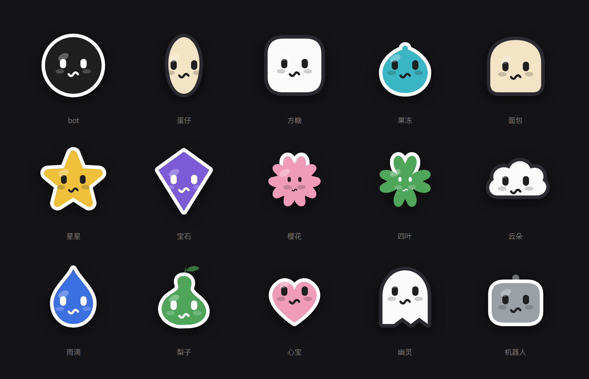
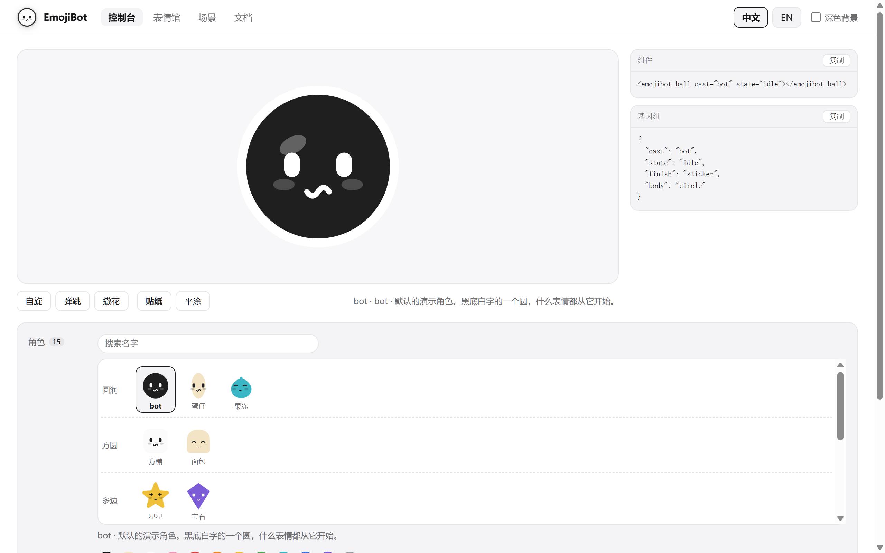

<div align="center">

# EmojiTot

**A character engine for the desktop and the web — <!--facts:cast-->15<!--/facts--> characters from <!--facts:bodies-->15<!--/facts--> bodies × hand-written outlines × <!--facts:colors-->12<!--/facts--> colours, <!--facts:faceStates-->44<!--/facts--> expressions driven by one two-digit number. Visible in a page, and now both a ball on the desktop and a pill at the top of the screen.**

[Console](https://onestar1107.github.io/emoji-tot/#/console) · [Faces](https://onestar1107.github.io/emoji-tot/#/gallery) · [Scene](https://onestar1107.github.io/emoji-tot/#/scene) · [Docs](https://onestar1107.github.io/emoji-tot/#/docs) · [中文](README.md)



> **About**
> A character engine drawn from hand-written outlines: <!--facts:cast-->15<!--/facts--> characters from <!--facts:bodies-->15<!--/facts--> bodies × <!--facts:colors-->12<!--/facts--> colours, and <!--facts:faceStates-->44<!--/facts--> expressions driven by one two-digit number. The desktop pet, the console and the site share one engine, with zero image assets.
>
> 一个用 SVG 画出来的角色引擎：<!--facts:cast-->15<!--/facts--> 个角色各有自己手写的闭合轮廓，<!--facts:faceStates-->44<!--/facts--> 个表情分生命周期 / 情绪 / 代理工作三组，默认模切白边画风。桌宠、控制台、站点共用同一套引擎，零图片资源。

</div>

---

## Download

<!--downloads:start-->
| File | For |
| --- | --- |
| [EmojiTot.Setup.0.3.38.exe](https://github.com/OneStar1107/emoji-tot/releases/download/v0.3.38/EmojiTot.Setup.0.3.38.exe) | Installer — starts from the Start menu |
| [EmojiTot.0.3.38.exe](https://github.com/OneStar1107/emoji-tot/releases/download/v0.3.38/EmojiTot.0.3.38.exe) | Portable — double-click, writes nothing to the registry |
<!--downloads:end-->

Windows x64 · unsigned (SmartScreen may ask you to run it anyway) · [all releases](https://github.com/OneStar1107/emoji-tot/releases)

> The version in the download table is kept in sync with `package.json` by `pnpm docs:sync`. If that release has not been tagged yet the links 404 — take the current published build from **all releases** above in that case.

## Two forms

The desktop app has two forms, switchable from the tray or the settings window without a restart:

| Form | Where | What it is |
| --- | --- | --- |
| **Island** (default) | top centre of the screen | a pill showing the face, battery, time and temperature; click and it expands into a 420px card |
| **Ball** | anywhere, docks to an edge | the original ball that hops, sulks and gets dragged around |

One three-way `displayMode` field chooses Island, Ball or Both. The ball is created at startup, while the island is created on first display. Switching only changes visibility, so the island keeps the page it was on.

The island sizes itself from its content: the page measures its own box with `ResizeObserver` and the main process calls `setBounds`, centred. The settings window has <!--facts:settingsPages-->14<!--/facts--> pages — general, appearance, size and position, hiding and interaction, cast and expressions, page manager, music and lyrics, focus and water, todos and shelf, notifications / mail / calendar, AI quota, weather, plugins, about — and every control writes straight to prefs with no save button.

## What this is

**A character is a genome, not an image.** No spritesheets, no Lottie files, and not one hand-drawn character: a character is `{ body, color, face }` — the body is a hand-written closed Bezier outline, the colour picks the ink for the face, and the expression is a small vocabulary of eyes and mouths. Add a row and there is a new character.

| Axis | Count | How |
| --- | --- | --- |
| Bodies | <!--facts:bodies-->15<!--/facts--> | circle, egg, squircle, blob, pear, drop, star, gem, loaf, blossom, clover, cloud, heart, ghost, tot — each outline written out by hand |
| Traits | <!--facts:traits-->26<!--/facts--> | <!--facts:earTraits-->6<!--/facts--> ears, <!--facts:topTraits-->8<!--/facts--> on top, <!--facts:sideTraits-->5<!--/facts--> on the sides, <!--facts:surfaceTraits-->6<!--/facts--> surface markings; each anchors to the body's height and pointiness |
| Finish | 2 | die-cut sticker (default) and flat, switched on the same outline |
| Colours | <!--facts:colors-->12<!--/facts--> | flat hexes; the face ink inverts by luminance |
| Expressions | <!--facts:faceStates-->44<!--/facts--> | <!--facts:eyeStyles-->9<!--/facts--> eye styles × <!--facts:mouthStyles-->10<!--/facts--> mouth styles plus lean, indexed by the protocol's state names |
| Characters | <!--facts:cast-->15<!--/facts--> | One per body, each with its own expression and motion |
| Offspring | unbounded | `breed(a, b, seed)` crosses two genomes; nothing is stored |

Three parts, all written from scratch in this repository:

| Part | Where | What it does |
| --- | --- | --- |
| Character engine | `packages/core` | Parametric bodies, trait anchoring, an expression vocabulary, four-layer composition, SVG out |
| Two-digit protocol | `packages/protocol` | Turns two digits into a state, with arbitration, an event bridge and forgiving parsing |
| Desktop & site | `apps/desktop` · `apps/gallery` | A pet that docks to the screen edge; console, cast wall, scene, docs |

## One two-digit number

The agent sends an id; the host turns it into a face. Ids are grouped by decade, and an unknown one falls back inside its decade instead of blanking the face.

| Segment | Ids | Meaning |
| --- | --- | --- |
| Lifecycle | `00`–`09` | asleep, waking, idle, spacing out, dragging |
| Feeling | `10`–`29` | happy, puzzled, down, surprised, shy, angry… |
| Agent work | `30`–`49` | thinking, busy, done, error, searching, writing… |
| Signalling | `50`–`59` | notify, scan, message |

```js
feed('34');                    // error: red bang + a shake
feed('{"emotionId":"33"}');    // done: confetti
feed('thinking');              // a bare state name works too
```

## The site



| Page | What is there |
| --- | --- |
| **Console** | Pick one of <!--facts:cast-->15<!--/facts--> characters, then adjust body, colour, traits and expression; the component snippet and the JSON genome follow every change |
| **Faces** | Two walls: the <!--facts:cast-->15<!--/facts-->-member cast wall (filter by family) and the <!--facts:faceStates-->44<!--/facts-->-expression wall; clicking a character jumps to the console |
| **Scene** | <!--facts:sceneHerd-->12<!--/facts--> characters on one stage, each changing expression on its own timer; click one and it answers; party / sleep / reshuffle |
| **Docs** | How the engine draws, how a genome is composed, what each digit means, how to call it — generated from code, so it cannot go stale |


## The desktop pet


The same ball can live on any desktop (Windows 10/11):

- **Edge docking** — drag it to a left or right edge and it tucks away, leaving 30% on screen; hover the sliver and it slides back out. The drop happens with the cursor on the edge, so it only opens after the pointer has left once.
- **Click-through** — the window never eats a click meant for the desktop behind it; input is taken back only when the pointer is on the ball.
- **Agent linkage** — DeepSeek Harness, Claude Code and Codex can each drive the face from their own status file.
- **One file is the whole interface** — `%APPDATA%/EmojiTot/state.json`. A bare id, a JSON string or a JSON object all work; malformed writes keep the current face.

```bash
echo '{"emotionId":"34","tips":"build failed"}' > "$APPDATA/EmojiTot/state.json"
```

## Quick start

```bash
pnpm approve-builds --all   # pnpm 12 skips dependency build scripts by default; Electron needs one
pnpm install
pnpm build       # builds core and protocol
pnpm typecheck   # type checks for both libraries
pnpm test        # protocol and engine tests
pnpm preview     # renders all <!--facts:protocolIds-->51<!--/facts--> protocol ids to out/preview.html
pnpm dev         # site at http://localhost:5173
pnpm desktop     # the desktop pet
pnpm scan        # sensitive-information scan, run before publishing
pnpm smoke:desktop  # launch a real Electron window and check the sandbox and layout
pnpm check          # full delivery verification on Windows
```

On Windows, Electron 45 cannot start from a repository path containing non-ASCII characters. The development launcher creates a one-time ASCII runtime cache (about 374 MB) under `%LOCALAPPDATA%\EmojiTot\electron-runtime`; set `EMOJITOT_ELECTRON_CACHE` to use another ASCII-only directory.

Package the app:

```bash
pnpm dist        # Windows installer lands in release/
```

## Layout

```
packages/protocol    zero runtime dependencies: <!--facts:protocolIds-->51<!--/facts--> ids, parsing, arbitration, event bridge (ESM + CJS)
apps/gallery         the site: console / faces / scene / docs
apps/desktop         the pet: docking, click-through, agent linkage, tray
```

## Verification

Not "it should run" — it was run:

| Check | Evidence |
| --- | --- |
| Protocol table | 33 protocol tests, 18 engine tests and 143 desktop tests covering ids, state mapping, event flags and segment bounds |
| <!--facts:protocolIds-->51<!--/facts--> protocol ids render | `pnpm preview` — <!--facts:protocolIds-->51<!--/facts--> ids → <!--facts:faceStates-->44<!--/facts--> faces, 51/51 and 44/44 pass, 0 failures, in Node with no browser |
| Desktop window behaviour | `node apps/desktop/scripts/ui-check.mjs <port>` — drives the real cursor, 7/7 (dock, open, tuck, click-through) |
| Desktop window smoke | `pnpm smoke:desktop` — launches the development or packaged app with a temporary profile, 7/7 (sandbox, preload, window size, shelf layout, paging targets) |
| Desktop protocol | write `34` → `alerting`, `33` → `celebrate`, malformed JSON → keeps the current face |
| Windows artifacts | `EmojiTot.Setup.0.3.33.exe` (about 116 MiB) and `EmojiTot.0.3.33.exe` (about 106 MiB); the unpacked build passes the same window smoke |

## Deliberate trade-offs

- **Urgent events interrupt.** Upstream always queues events until the dwell ends; here an event that outranks what is on screen interrupts it — a failure must be seen immediately — while lesser ones still queue, so bursts do not flicker.
- **Static colours are rewritten, not inverted.** The static renderer writes its ink as a `prefers-color-scheme` media query; pinning a page colour means rewriting that query. A CSS invert would flip the blush and the bang too.
- **Click-through polls the cursor.** `setIgnoreMouseEvents(forward)` did not forward mousemove on the test machine, so the page never learned the pointer was on the ball and the ball could neither be clicked nor dragged. Polling the cursor every 60 ms behaves the same on both platforms.

## Licence

**MIT.** The engine, the protocol, the pages and every character were implemented from scratch in this repository: use it commercially, close-source it, redistribute it — keep the copyright notice.

No third-party character engine's code or art is included.

---

Made by [OneStar1107](https://github.com/OneStar1107) · [MIT](LICENSE)
