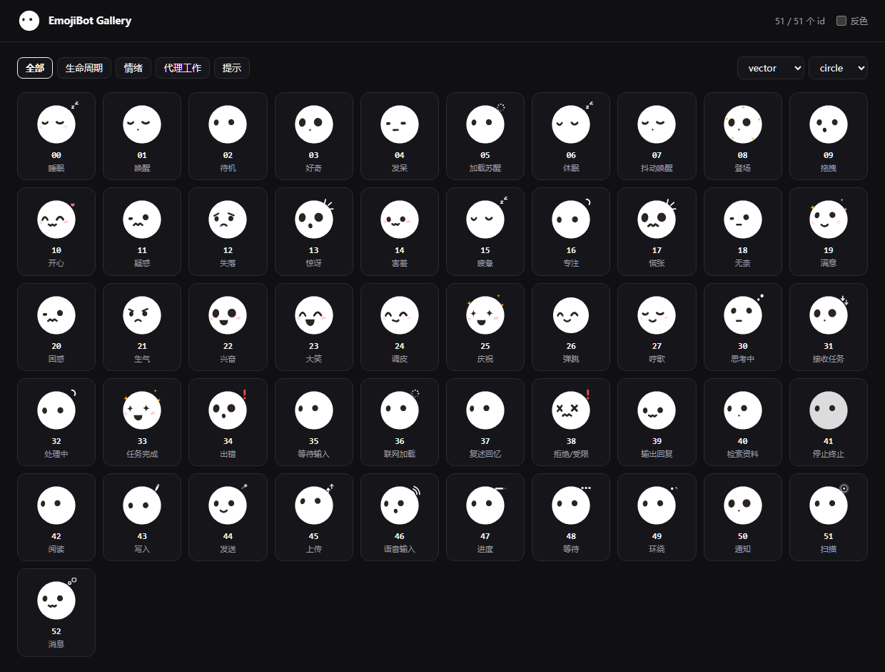
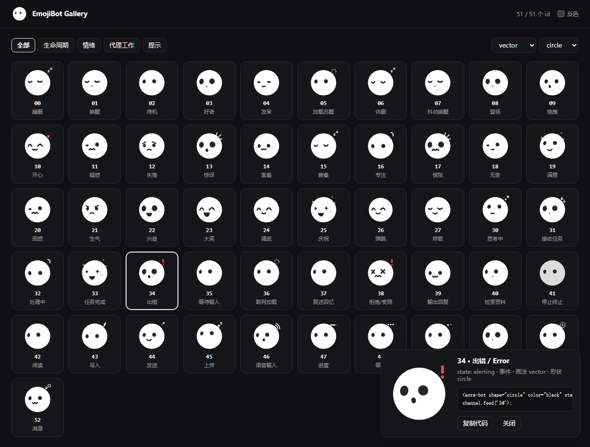
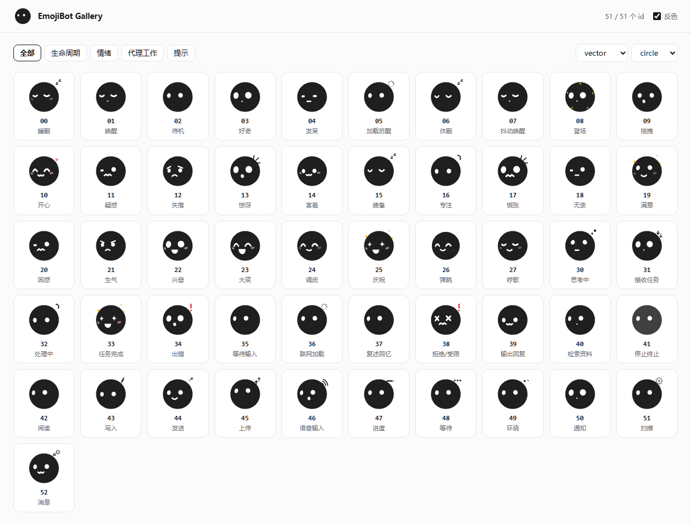

# EmojiBot Studio

把「发一个 id，角色就动」做到能用、能测、能开源的融合项目。

它把三个上游合成一层：**Emotion Ball** 的数字表情协议、**Aora Bot** 的程序化角色引擎、
**球球桌宠** 的桌面常驻经验。协议是你唯一需要学的东西——一个两位数，角色自己知道该做什么表情。

> 非商业衍生作品。许可与署名见 [LICENSE](LICENSE)、[NOTICE.md](NOTICE.md)、[CREDITS.md](CREDITS.md)。



<details>
<summary>点开一张卡片</summary>



</details>

<details>
<summary>反色：钉死明暗，不跟随系统</summary>



</details>

## 三十秒理解

```js
feed('34');                    // → 出错：红色感叹号 + 身体抖动
feed('{"emotionId":"33"}');    // → 任务完成：撒花
feed('thinking');              // → 也可以直接给状态名
```

id 按十年分段，接不认识的 id 也不会白屏——它知道大概是哪一类，退回这个月段的合理表情：

| 段 | id | 含义 |
| --- | --- | --- |
| 生命周期 | `00`–`09` | 睡眠、唤醒、待机、发呆 |
| 情绪 | `10`–`29` | 开心、疑惑、失落、惊讶、害羞… |
| 代理工作 | `30`–`49` | 思考中、处理中、任务完成、出错、检索… |
| 提示 | `50`–`59` | 通知、扫描、消息 |

## 仓库结构

```
packages/protocol/   零运行时依赖：协议表、解析、多会话仲裁、事件桥
apps/gallery/        站点四视图：控制台 / 表情馆 / 主题 / 文档（中英）
apps/desktop/        桌面宠物：贴边收起、点击穿透、Agent 联动、托盘
```

## 站点

`pnpm dev` 打开后有四页：

| 页面 | 内容 |
| --- | --- |
| **控制台** | 71 角色 · 71 形状 · 11 色 · 3 画法 16 变体 · 51 状态。参数面板只显示当前变体真正读取的参数，代码片段随选择实时生成 |
| **表情馆** | 51 个 id 一屏看完，按十年段筛选，点开拿代码 |
| **主题** | 7 套季节主题（万圣/圣诞/春节/中秋/复活节/夏/情人节），点击才加载 |
| **文档** | 接入、协议、命令式动作、桌面端，中英切换 |

## 跑起来

```bash
pnpm install
pnpm --filter @emojibot-studio/gallery dev      # 打开 http://localhost:5173
node apps/gallery/scripts/preview.mjs          # 无头验证 51 个状态，生成 out/preview.html
pnpm --filter @emojibot-studio/protocol test # 27 个测试，含与上游逐行比对
```

## 这一版做了什么

- **协议包自研**：表、解析、仲裁、事件桥，零依赖。27 个测试里 4 个是**与上游 `@aora-bot/engine` 逐行比对**，
  上游改表就会红，不会悄悄漂移。
- **仲裁器比上游多做一条**：错误这类「事件」如果比当前显示更紧急，会**立即打断**停留期（上游一律排队等 900ms），
  失败必须马上看见；不紧急的事件仍然排队，避免连续事件把脸刷成闪烁。
- **画法来自引擎**：同一份 state 出 vector / pixel / kaomoji 三种画法，52 个 id 全部有静态渲染。
- **无浏览器也能验证**：`preview.mjs` 在 Node 里把 51 个状态渲染成 SVG 并排成墙。
- **展示馆不用手抄代码**：点开任意一张卡片，得到可以直接粘进项目的两行。
  切换画法时 51 张静态图一起重画；「反色」钉死页面配色，静态图跟着重写媒体
  查询（用 CSS invert 会把腮红和感叹号一起反掉）。
- **桌面端读文件就够**：透明置顶窗口 + 托盘 + 右键菜单，外部只写 `state.json`。
  坏 JSON 不会让脸消失（保留当前表情），裸 id、JSON 串、JSON 对象三种写法都收。

桌面端还做了三件事：

- **贴边收起**：拖到屏幕左右边缘松手，球缩进去只留一条，悬停滑出来。
- **点击穿透**：窗口默认不拦点击，透过去的桌面图标照样能点；指针落到球上才收回输入。
- **Agent 联动**：菜单里可开 DeepSeek Harness / Claude Code / Codex，读它们各自的状态文件并映射成表情。

出安装包：

```bash
pnpm --filter @emojibot-studio/desktop dist   # release/ 下出 Windows 安装包
```

## 还没做

- 贴边收起、鼠标穿透、Codex 类联动
- 参数面板（`styleOptions` 还没透出）
- CI、首个 release

## 许可

非商业共享。三个上游各自许可继续有效，商用需要分别联系原作者（aora-bot 与 emotion-ball 的
商业授权邮箱为 1251579308@qq.com；球球桌宠**永不提供**商业授权）。细节见 [NOTICE.md](NOTICE.md)。

---

Powered by [Aora Bot](https://github.com/sam70361/aora-bot) · 表情语义来自
[Emotion Ball](https://github.com/Aithena/emotion-ball) · 桌面设计参考
[球球桌宠](https://github.com/dreamcall520/emotion-ball-desktop-pet)