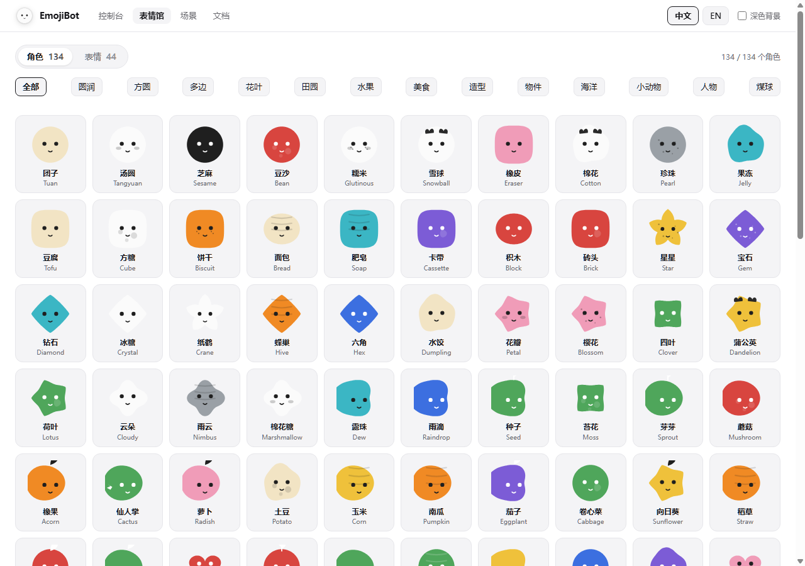

<div align="center">

# EmojiBot

**面向桌面与 Web 的角色引擎 —— 134 个角色来自 15 种身体 × 26 种特征 × 12 色，44 个表情由一个两位数驱动；网页里看得见，桌面上养得起。**

[控制台](https://onestar1107.github.io/emoji-bot/#/console) · [表情馆](https://onestar1107.github.io/emoji-bot/#/gallery) · [场景](https://onestar1107.github.io/emoji-bot/#/scene) · [文档](https://onestar1107.github.io/emoji-bot/#/docs) · [English](README.en.md)


</div>

---

## 这是什么

**角色不是图片，是一段基因。** 没有雪碧图，没有 Lottie 文件，也没有 134 张手绘的图：一个角色是 `{ body, color, traits, state }` 四项，身体来自参数化公式，特征会自己贴着身体找位置，表情是眼型与嘴型的一小套词汇。加一行就有新角色——这是组合式阵容和预绘图阵容的根本区别。

| 维度 | 数量 | 说明 |
| --- | --- | --- |
| 身体 | 15 | 圆、蛋、方圆、水滴、星、宝石、花瓣、云、心、幽灵、机器人…都由 `r(t)` 或参数曲线采样生成 |
| 特征 | 26 | 耳朵 6、头顶 8、身侧 5、表面 6，锚点读身体的高度与尖度 |
| 颜色 | 12 | 实色；五官墨色按亮度自动取反 |
| 表情 | 44 | 6 种眼型 × 7 种嘴型 + 偏移，由协议里的状态名索引 |
| 角色 | 134 | 13 个族，每个都有中英双名和一句话 |
| 后代 | 无限 | `breed(a, b, seed)` 交叉两个角色的基因，不落库 |

本项目把三个上游合成一个能跑的东西，各自出力：

| 上游 | 贡献 | 位置 |
| --- | --- | --- |
| [Emotion Ball](https://github.com/Aithena/emotion-ball) | 两位数 emotionId 协议的分段思路（代码自己写） | `packages/protocol` |
| [Aora Bot](https://github.com/sam70361/aora-bot) | "角色由代码绘制"这条路能走多远的参照（不含其代码或美术） | `packages/core` |
| [球球桌宠](https://github.com/dreamcall520/emotion-ball-desktop-pet) | 桌面常驻的产品行为：贴边、穿透、状态气泡 | `apps/desktop` |

## 一个两位数

AI 侧只发一个 id，宿主把它变成表情。id 按十年分段，接不认识的也不会白屏——它知道大概是哪一类，退回这个段里合理的表情。

| 段 | id | 含义 |
| --- | --- | --- |
| 生命周期 | `00`–`09` | 睡眠、唤醒、待机、发呆、拖拽 |
| 情绪 | `10`–`29` | 开心、疑惑、失落、惊讶、害羞、生气… |
| 代理工作 | `30`–`49` | 思考中、处理中、任务完成、出错、检索、写入… |
| 提示 | `50`–`59` | 通知、扫描、消息 |

```js
feed('34');                    // 出错：红色感叹号 + 抖动
feed('{"emotionId":"33"}');    // 任务完成：撒花
feed('thinking');              // 也可以直接给状态名
```

## 站点


| 页面 | 内容 |
| --- | --- |
| **控制台** | 134 个角色任选，15 身体 · 12 色 · 26 特征 · 44 表情逐项可调；组件片段与 JSON 基因组随选择实时生成 |
| **表情馆** | 两个墙：134 个角色的阵容墙（按族筛选），和 44 个表情的表情墙；点角色跳去控制台，点表情带着状态过去 |
| **场景** | 十四个角色同台，各自按自己的节奏换表情；点它会回应你，还有"全体开心 / 全体入睡 / 换一批" |
| **文档** | 引擎怎么画、基因组怎么组、协议每一位什么意思、怎么调用，全部由代码生成，不会过时 |


## 桌面宠物



同一个球可以贴在任何桌面上（Windows / macOS）：

- **贴边收起**：拖到屏幕左右边缘松手，球缩进去只留 30%，悬停滑出来。松手时光标就在边缘，所以必须移开过一次才会响应悬停——否则刚放下就被自己弹开。
- **点击穿透**：窗口默认不拦点击，底下的桌面图标照样能点；指针落到球上才收回输入。
- **Agent 联动**：菜单可开 DeepSeek Harness / Claude Code / Codex，读各自的状态文件并映射成表情。
- **一个文件就是接口**：`%APPDATA%/EmojiBot/state.json`（macOS 在 `~/Library/Application Support/EmojiBot/`）。裸 id、JSON 串、JSON 对象都收，坏数据保留当前表情。

```bash
echo '{"emotionId":"34","tips":"构建失败了"}' > "$APPDATA/EmojiBot/state.json"
```

## 快速开始

```bash
pnpm install     # 装完会自动构建协议包（postinstall）
pnpm dev         # 站点 http://localhost:5173
pnpm desktop     # 桌面宠物
pnpm test        # 27 个协议测试，含与上游逐行比对
```

出安装包：

```bash
pnpm --filter @emojibot/desktop dist   # release/ 下出 Windows 安装包
```

## 项目结构

```
packages/protocol    零运行时依赖：51 个 id、解析、多会话仲裁、事件桥（ESM + CJS）
apps/gallery         站点五视图：控制台 / 表情馆 / 场景 / 主题 / 文档
apps/desktop         Electron 桌宠：贴边、穿透、Agent 联动、托盘
```

## 验证

不是"应该能跑"，是跑过：

| 检查 | 证据 |
| --- | --- |
| 协议表 | 27 个测试，其中 4 个与 `@aora-bot/engine` 逐行比对 id / state / 事件标记 / 段边界，上游改表就红 |
| 51 个状态渲染 | `node apps/gallery/scripts/preview.mjs` — 51/51，0 failures（Node 里跑，无浏览器） |
| 桌面端窗口行为 | `node apps/desktop/scripts/ui-check.mjs <端口>` — 用原生光标驱动真实拖拽，7/7（贴边、展开、收起、穿透） |
| 桌面端协议驱动 | 写 `34` → `alerting`，写 `33` → `celebrate`，写坏 JSON → 保持当前表情 |

## 几处有意的取舍

- **紧急事件立即打断**：上游的仲裁一律让事件排队等停留期；这里改成"比当前显示更紧急的事件立即打断"——出错必须马上看见，不紧急的仍然排队，避免闪烁。
- **静态图的配色靠改字符串**：静态渲染把 ink 写成 `prefers-color-scheme` 媒体查询，页面钉死配色时只能重写这段查询；用 CSS invert 会把腮红和感叹号一起反掉。
- **穿透靠轮询光标**：`setIgnoreMouseEvents(forward)` 在本机没有转发 mousemove，页面永远不知道指针在球上，球既点不动也拖不动。改成主进程每 60ms 查一次光标位置，两个平台一致。

## 许可

**MIT。** 代码、形状、表情全部由本仓库自行实现：可以商用、可以闭源、可以再分发，保留版权声明即可。

设计上的来路见 [NOTICE.md](NOTICE.md)（只有致谢，不含任何许可约束）。

> 早期版本直接依赖上游引擎，能拿到 71 个角色和 16 种画法，但整个仓库只能是"非商业衍生作品"。
> 为了让许可干净，引擎重写成了 `packages/core`：8 个形状、44 个状态表情、一种画法。
> 功能少了，许可见得清楚了——这是有意的取舍。

---

Powered by [Aora Bot](https://github.com/sam70361/aora-bot) · 表情语义来自 [Emotion Ball](https://github.com/Aithena/emotion-ball) · 桌面设计参考 [球球桌宠](https://github.com/dreamcall520/emotion-ball-desktop-pet)