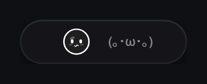
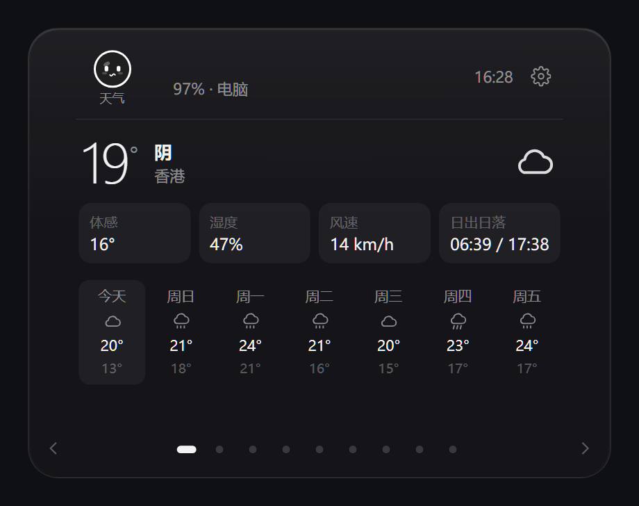
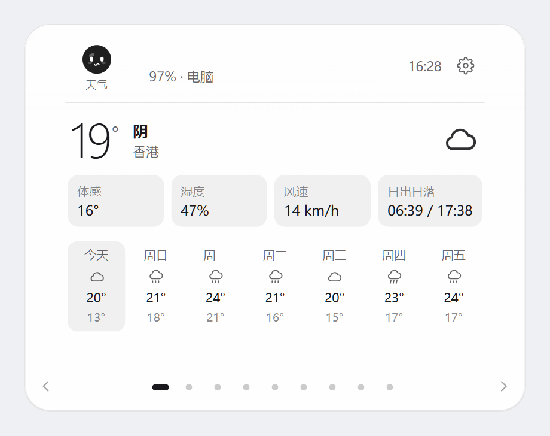

# 灵动岛形态 / Island

tot 的第二种形态：贴在屏幕顶部中间的一条胶囊。录制媒体播放时显示固定文字槽里的同步歌词；音乐暂停后回到状态行并保留一个可配置空闲时间的恢复按钮。点击展开成一张卡片，横向翻页放功能。

| 收起 · frost | 展开 · frost |
| --- | --- |
|  |  |

| 展开 · frost · 浅色 |
| --- |
|  |

> 一句话：不是 macOS 刘海，也不是一条横贯屏幕的岛 —— 是「顶部居中、按内容长宽、点击展开」的一个 tot。

## 1. 形态与尺寸

| 状态 | 宽 | 高 | 内容 |
| --- | --- | --- | --- |
| 收起 pill | 168 – 用户设置上限 | 40（滑块 30）– 58（滑块 44） | tot 的脸（26–38px）+ 媒体歌词、状态组件或暂停恢复按钮；播放时文字槽固定，超出后省略 |
| 展开面板 | 用户设置宽（默认 420） | 按页面 300–380 | 顶栏（脸/播放标题/电量/时间/齿轮）+ 页面区 + 分页点 |
| 展开 + 通知 | 用户设置宽（默认 420） | 按内容最多 460 | 临时插页，3.5s 后回到原页 |

窗口 = 内容尺寸 + 留白（左右 32px、上下 36px）。收起窗口跟随胶囊实测宽度，展开窗口使用用户设置的岛宽；主进程按渲染层上报的 box 调用 `setBounds`。胶囊变宽前先把原生窗口扩到目标宽度，变窄时等弹簧落定后再收缩，所以窗口边缘不会切到运动中的文字。

收起胶囊的左右内沿不是两个相同的 CSS 数字：角色图形自身带一圈透明内缩，所以左侧用 `12px`，右侧用 `23.5px`。按实际可见墨迹测量，角色边缘到左外沿约 `24.9px`，文字裁切边缘到右外沿约 `24.2px`，误差小于 `1px`。这样修的是光学空隙，而不是只让 DOM 盒子的 padding 数值相等。

### 顶栏那一行放什么

展开面板的顶栏只放正在播放的标题。页名常驻在头像下面（9px），超长时内层 span 跑马灯。收起胶囊另有一条两行媒体区：第一行显示当前同步歌词，第二行显示“歌名 - 歌手”；歌词尚未到达时第一行回退到歌名。文字槽固定为 `240px * --ui-scale` 与岛宽剩余空间中的较小值，两行都右端省略。歌词切句只原位替换文字，不会重新测量胶囊，所以播放过程中不会跟着歌词伸缩。

播放中的音乐一旦暂停，收起胶囊立即回到电量、时间、温度、余额等状态行，展开页同时收起。右侧固定槽里保留一个小封面 / 播放按钮，点击直接继续当前歌曲；按钮默认空闲 15 分钟后隐藏，可在“音乐与歌词 → 暂停后的灵动岛”选择永不隐藏、1、15、30、60 或 120 分钟。鼠标移到按钮上或键盘聚焦会重新计时。保留时间结束时，暂停音乐不再锁定媒体归属，系统会重新识别正在播放的直播、视频或其他媒体；没有别的媒体时回到空闲状态。再次展开时先显示常规页面，不会自动进入暂停歌词页。

媒体页不再重复顶栏歌名。封面右侧固定展示上一句、当前句、下一句，当前句 17px、行高 1.32，长句最多两行。媒体来源的优先级是音乐 > 有限时长视频/播客/普通媒体 > 直播 > 未知媒体；正在播放的音乐始终优先，暂停音乐只在恢复按钮的保留窗口内保持归属。窗口结束后，直播或其他媒体接管画面与控制，音乐重新播放时立即夺回。标题、封面、进度和歌词始终来自同一个胜出来源。

## 2. 位置

- 水平居中于「当前显示屏」的工作区；垂直贴工作区顶部（`y = workArea.y`）。
- 多显示器：跟随设置里选的屏；屏被拔掉时回主屏（`screen.on('display-removed')`）。
- 不占用任务栏、不进 Alt+Tab、不在全屏应用上出现（设置可调）。

## 3. 交互

| 动作 | 结果 |
| --- | --- |
| 左键点 pill | 展开到上次停留的页 |
| 左键点面板外 | 收起（渲染层失焦 + 主进程 blur 兜底） |
| 右键 | 托盘菜单（与球共用一个菜单，只是多「切到球形态」） |
| 横向滚轮 / 底部圆点 | 换页 |
| 悬停 pill 300ms | 轻微放大 1.04，不展开（防误触） |
| 拖拽 pill 横向 | 移动位置（可选，默认关闭） |

缩放：`win.webContents.setZoomFactor(display.scaleFactor)` 风险大，改为 CSS 用 `devicePixelRatio` 自适应，不上 zoomFactor。

## 4. 页面注册表

页面与状态组件由 `src/shared/schema.js` 声明（`PAGE_MANIFEST` / `STATUS_MANIFEST`），设置页只改开关与顺序，岛只按注册表渲染。关掉一页会同时停掉它的后台服务，除非胶囊里的状态组件还要用。

| key | 名称 | 阶段 | 数据源 |
| --- | --- | --- | --- |
| `music` | 音乐 | 已实现 | PowerShell + WinRT SMTC；歌词 LRCLIB |
| `weather` | 天气 | 已实现 | Open-Meteo（PowerShell 子进程） |
| `quota` | AI 额度 | 已实现 | DeepSeek `/user/balance`，密钥 safeStorage |
| `mail` | 邮箱 | 已实现 | IMAP（imapflow），验证码 + .ics 提取 |
| `focus` | 专注 | 已实现 | 结束时间戳 + 通知 |
| `todo` | 待办 | 已实现 | 本地 JSON，到期提醒一次 |
| `health` | 健康 | 已实现 | 喝水 / 久坐计时 + 通知 |
| `shelf` | 置物架 | 已实现 | 复制式收纳，路径或字节都能收 |
| `calendar` | 日程 | 已实现 | 本地 JSON + ICS 解析 |
| `devices` | 设备 | 已实现 | PowerShell PnP，电量与连接状态 |

状态组件（常驻 pill，不占页）：电量、时间、温度、余额、颜文字。顺序可拖，可单独开关；颜文字默认关闭，并且只在至少一个真实读数存在时出现。

## 5. 通信

```
renderer(island) --island:box {w,h}--> main  → 按内容宽度 setBounds 居中
renderer --island:hover bool--------> main  → setIgnoreMouseEvents 兜底
main --island:* data---------------> renderer
main --face:apply {state,source,at,seq}--> 球窗口 + 岛窗口：表情只在主进程持有，变化广播同一份载荷
                                  （页面重载/重连时 main 立即重发当前值；渲染层不能上报表情）
```

尺寸同步用 `ResizeObserver` + microtask 合并。内容变化时先以 `max-content` 测目标胶囊宽度；扩容在宽度弹簧开始前写成新的原生 stage，缩容等弹簧结束后再上报。`MutationObserver` 只监听胶囊内容，不用 `window.resize`，避免原生 `setBounds` 反过来触发宽度弹簧。

## 6. 与球形态的关系

- 设置项 `displayMode: 'island' | 'ball' | 'both'`，默认 `island`。它同时决定当前显示和下次启动；同屏时岛贴顶、球贴边，互不抢焦点。
- 旧版 `form` / `formBoth` 在读取时迁移到 `displayMode`，新值存在时优先使用新值。
- 托盘菜单永远提供另一个形态的一键切换。

## 7. 自动避让

浏览器盖住岛时，岛不该挡在半屏直播或文档标题上。开启 `avoidEnabled` 后，岛收成一条 5px 的横条，鼠标可穿过，浏览器让开或失焦后自动还原。

默认开启。理由不是「参考谁」，是这个默认值的两个失败方向不对称：岛默认坐在屏幕顶部正中，也就是最大化浏览器的标签栏位置；不避让的话它就一直压着标签，而新用户要么忍着要么去设置里找开关（很难发现）。反过来，避让生效时原地会留一条 5px 横条，鼠标进去就展开，找回来的路只要一次悬停。范围也窄——只对浏览器和用户自己加的应用生效，进程枚举一次 0.02% CPU。

判定在主进程外：`services/avoidance.ps1` 常驻轮询前台窗口（100ms 一行 `1/0`），只认两类目标——启用 `avoidBrowsers` 时的内置浏览器名单（名单之外，Chromium 系浏览器按 `Chrome_WidgetWin_1` 窗口类加地址栏控件 `Chrome_OmniboxView`／安装目录里的 `chrome.dll` 自动识别，同样用这个窗口类的 Electron 应用不算），和 `avoidApps` 里按 exe 完整路径匹配的自定义应用；插件浮窗会沿 owner 链回落到宿主窗口。判定条件是：前台窗口的可见矩形是否覆盖岛的中间带，最小化的窗口不算。

悬停判定按**画出来的那一条**算，不按窗口算：窗口带着 32/36px 透明留白，拿窗口当命中区时指针只是路过空白也会展开。渲染层用 `reportHit()` 把 `#frame` 的实时尺寸（pill 222×34 / 面板 / 横条 93×5）发给主进程，主进程的 `contentRect()` 才是命中矩形。

悬停或点击那条横条就是正常展开：避让是内容状态，不是窗口状态——`syncAvoidVisual()` 只在 `avoiding && !open` 时收成条，岛一打开（面板 300px）就按面板尺寸上报，鼠标离开、岛收起后再回到横条。收缩期间不放开上报的话，面板会被 5px 的 `overflow:hidden` 裁掉，看起来就是"鼠标放上去没反应"。

收缩的是内容，不是窗口：`#frame` 拿到 `--avoid-w`（自身宽度的 42%）与 5px 高度，窗口尺寸保持不变。这条很重要——收缩态一旦上报 box，窗口就会跟着缩，判定用的 pill 矩形随之移动，状态会在两帧之间来回翻。所以收缩期间 `measure()` / `reportBoxNow()` 直接跳过。

避让矩形取实测的 pill，不是用 `PAD_X` / `PAD_Y` 反推：页面把 `#frame` 水平居中、贴顶，窗口那 36px 实际全在下方，按 `PAD_Y` 减会把判定框往下挪 36px。

## 8. 材质与尺寸过渡

深度只用「画在盒子里」的手段做：顶边一像素高光 `--hi`、底边一像素暗边 `--lo`、1px 内描边 `--ring`。透明 Electron 窗口会把画出边界的阴影裁成直边（面板周围那圈「多余的一层」就是这么来的），所以面板没有外阴影，浅色主题下也没有，靠描边拉开与桌面的距离。

展开/收起由 `renderer/island.js` 的一条解析弹簧驱动：`geometryAt()` 从同一个进度采样宽度、高度和四个圆角，`paintMorph()` 用圆角裁切面板并在同一帧更新命中区。面板不缩放，内容也不做反向缩放，所以角色、文字和表面不会逐帧错位。收起前先同步测好胶囊的最终宽度；面板和胶囊不会同时参加 flex 排版（两者都 `flex: none`，收起时胶囊脱离普通流），不会出现先量成 168px、面板隐藏后又长回去的两段式变化。原生窗口在展开前预扩容，收起后等胶囊完成两帧绘制再缩容。

圆角、间距、动效曲线都收在 `renderer/island.css` 的 `:root` 令牌里（`--r-*`、`--fast/--base/--slow`、`--spring/--ease`）；`--radius`、`--pill-h`、`--island-w` 由设置在运行时覆盖，所以 `startMorph()` / `geometryAt()` 读的是实时计算值，不写死默认宽度或圆角。

同一套令牌名在另外两个窗口里也有：`renderer/settings.css` 用 `--r-*`／`--fast`／`--base`／`--slow`／`--ease`／`--spring`／`--hi`／`--surface-*`，`renderer/style.css`（球形态的对话气泡）用 `--r-*` 与 `--base`／`--ease`。设置窗口以前把这些写死成 6/7/8/9/11/12/14px 与 rgba(255,255,255,·) 的白色叠层——浅色主题下 5% 白叠在 #ffffff 上等于没有，输入框、悬停、开关轨道全都消失；换成 `--surface-*` 后两个主题共用同一份语义。字体偏好（设置 → 外观 → 字体）也改成两边都读 `--ui-font`，不再是「岛变了、设置窗没变」。
